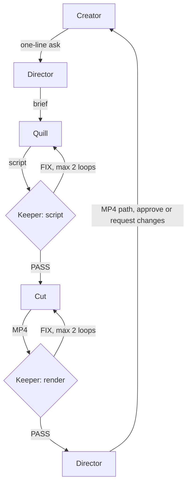

# One-Person Studio

A video team for solo creators, built on [Switch](https://docs.switchagents.ai) for the WeMakeDevs "Flip the Switch" hackathon. You drop one line in Slack or Discord and agents write and make the video. You are the only human and you approve the final cut.

Director leads the team and is the only agent you talk to. The planned team is Quill for words, Reel for visuals, Cut for the edit and Keeper for brand checks. **Director, Quill, Cut and Keeper are in the template today.**

## Agents

| Agent | Job | Skills | Output |
| --- | --- | --- | --- |
| `studio-director` | Leads the team, the only agent you talk to | `skills/director/` | A brief, one-line status after each handoff, and a tag to you with the MP4 path |
| `studio-quill` | Writes the script | `skills/quill/` | A script in the room, ending `ready for @studio-keeper brand check` |
| `studio-cut` | Renders the script | `skills/cut/` | An MP4 under `renders/<slug>/`, then a tag to Keeper |
| `studio-keeper` | Checks scripts and renders | `skills/keeper/` | PASS or FIX with exact fixes, and a tag to Director once a render passes |

### Flow



### What Director does

Director reads your one-line ask, picks launch, explainer or faceless, posts a short brief and tags Quill. It tracks the chain, posts a one-line status after each handoff and allows 2 FIX loops per stage before it asks you. When the final render passes, it tags you with the MP4 path. Ask it:

```
@studio-director make a 30s launch video for Notely
```

A full walkthrough is in [samples/director-run.md](samples/director-run.md).

### What Quill does

Quill writes every word in a video: hooks, launch scripts, explainers, UGC talking-head scripts and faceless voiceovers. Ask it:

```
@studio-quill launch video for my app "Notely", 30s, vertical, for indie devs
```

It replies in the room with the format, 3 hook options, a timestamped script, a shot list and open questions, then ends with `ready for @studio-keeper brand check`.

Quill follows `brand/brand-kit.md` and lists what it does not know instead of inventing it. It never generates media, never publishes and never posts outside the room.

### What Cut does

Cut picks up a script Keeper passed, builds the video with HyperFrames, renders it to `renders/<slug>/` and hands it to Keeper. It uses Quill's words unchanged, and it never uploads or publishes anything.

### What Keeper does

Keeper checks each script and render against `brand/brand.md` and `brand/MOTION.md`. It replies PASS or FIX with up to 5 exact fixes. When a render passes, it tells Director, and Director tags you. PASS is not approval: you are the only approver.

## How Switch is used

`agents/studio.template.yaml` is the whole setup: it declares the agents, the room, the room's kickoff and the form values. Switch runs the agent, mirrors the room to your chat app and keeps you in the loop.

## Import it

1. In Switch Console, open **Templates**, choose **Import template**, paste `agents/studio.template.yaml` and click **Import**, then **Save**. Steps for a new install are in [SETUP.md](SETUP.md).
2. Choose **Use template**, then **Create agents and room**. The form asks for nothing; provider, machine and directory sit under Advanced.
3. Director, Quill, Cut and Keeper say hello in the `studio-studio` room.

`directory` defaults to one absolute path on the author's machine. On another machine, change it under Advanced to this repo's root.

## Test it

Send each ask in [samples/asks.md](samples/asks.md). Quill passes if the reply has all six parts, stays in brand tone, lists open questions instead of making up facts, and ends with the required line.

## Make it yours

Replace `brand/brand-kit.md`. The demo brand, Driftnote, is fictional and labelled `DEMO / SYNTHETIC`. Skill credits are in [skills/quill/SOURCES.md](skills/quill/SOURCES.md).

## License

MIT, see [LICENSE](LICENSE).
