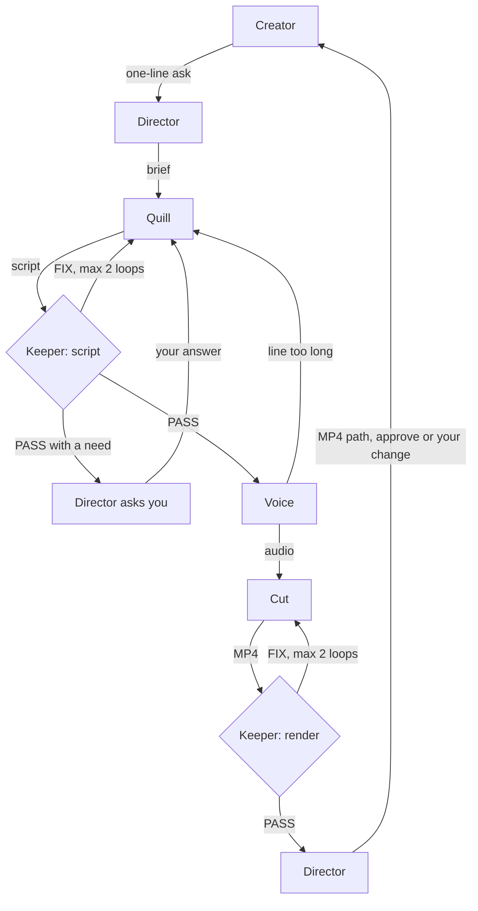

<!-- Banner goes here: <p align="center"></p> -->

<p align="center">
  
  
  
</p>

# One-Person Studio

**A video team for solo creators that lives in your chat. You send one line, and five AI agents write it, voice it, render it and check it. You approve the final cut.**

If you make videos alone, you are the writer, the editor and the person checking your own work at 2am. One-Person Studio gives you a small team instead. You drop one line in a Switch room, something like "make a 30s launch video for Notely", and five agents take it from there. If a fact is missing, the team stops and asks you instead of guessing, and nothing is final until you approve it.

Built on [Switch](https://docs.switchagents.ai) for the WeMakeDevs "Flip the Switch" hackathon.

<!-- Demo video link goes here: **▶️ [Watch the demo](URL)** -->

### At a glance

- **5 agents in one Switch room**, all declared in a single template: [agents/studio.template.yaml](agents/studio.template.yaml).
- **You talk to one agent.** Director routes the rest, and every handoff is a plain `@mention` you can read in the room.
- **Facts are never invented.** A missing price or link becomes `[need: ...]`, and the chain stops until you answer.
- **Nothing gets published.** Agents never upload or post, and only you can approve a video.

## The team

<!-- Agent logos go here, one per agent, 96px wide, above the table. -->

| Agent | Purpose | Output | Skills |
| --- | --- | --- | --- |
| **Director** `studio-director` | Leads the team. The only agent you talk to | A brief, a one-line status after each handoff, and a tag to you with the MP4 path | [skills/director/](skills/director/) |
| **Quill** `studio-quill` | Writes every word in the video | Hook options, a timestamped script, a shot list and open questions | [skills/quill/](skills/quill/) |
| **Voice** `studio-voice` | Speaks the script | One audio clip per beat under `renders/<slug>-voice/` | [skills/voice/](skills/voice/) |
| **Cut** `studio-cut` | Renders the script with Remotion and remocn components | An MP4 under `renders/<slug>/`, measured with `ffprobe` | [skills/cut/](skills/cut/) |
| **Keeper** `studio-keeper` | Checks scripts and renders against your brand | PASS or FIX with up to 5 exact fixes | [skills/keeper/](skills/keeper/) |

**Director** reads your ask, picks launch, explainer or faceless, posts the brief and tags Quill. It posts a one-line status after each handoff and allows 2 FIX loops per stage before it asks you. If a script still holds a `[need: ...]`, it stops and asks you for the fact.

**Quill** writes hooks, launch scripts, explainers, UGC talking-head scripts and faceless voiceovers. It follows `brand/brand.md` and `brand/MOTION.md`, and it lists what it does not know instead of inventing it.

**Voice** reads Quill's Spoken lines word for word and makes one clip per beat. It uses Kokoro if installed, then the macOS voice, then no audio, so a missing tool never stops the chain. It says in the room which one it used.

**Cut** picks up Voice's audio and the script Keeper passed, builds the video and renders it. It uses Quill's words unchanged.

**Keeper** holds the brand. It checks each script and render, then tells the next agent what to do. PASS is not approval: you are the only approver.

Reel, an agent for visuals, is planned and not built yet.

## How it works



You ask Director in the main room, and it opens a new room for that video from [agents/video-room.template.yaml](agents/video-room.template.yaml). The whole flow above runs in that room, so each video keeps its own history and its own `renders/<video>/` folder. A new video gets a new room, and you archive finished rooms yourself.

## What it looks like

<!-- Screenshots go here: the room in Slack or Discord, and a frame from a rendered video. -->

These are the expected messages in the room, shortened. The full version is in [samples/director-run.md](samples/director-run.md).

```
you:       @studio-director make a 30s launch video for Notely

Director:  What is Notely, and who is it for?

you:       @studio-director A notes app for indie devs.

Director:  BRIEF | Notely launch
           Format: launch · Length: 30 · Aspect: 9:16
           @studio-quill write this

Quill:     (hooks, script, shot list, open questions)
           ready for @studio-keeper brand check

Keeper:    BRAND CHECK | script | Notely launch
           Verdict: FIX
           84 spoken words, the limit for 30s is 70
           Next: @studio-quill please revise

Director:  script ✓ · brand FIX 1 of 2 · revising…

Keeper:    Verdict: PASS
           Next: @studio-voice make the voice

Voice:     Tier: kokoro
           @studio-cut render it

Cut:       renders/notely/notely.mp4
           30.0s, 1080x1920, 9:16 (from ffprobe)
           @studio-keeper check render

Keeper:    Verdict: PASS
           Next: @studio-director approved render

Director:  @you renders/notely/notely.mp4
           reply @studio-director approve or your change

you:       @studio-director approve

Director:  Creator approved. Closed. Nothing published.
```

## Why this needs Switch

Take Switch away and there is no studio. This repo has no chat app code and no orchestrator: it is a template, skills and a brand kit.

- **The template is the whole setup.** One file declares the agents, the room, the room's rules and the kickoff. Import it and the team exists.
- **The room is the pipeline.** Agents hand off with `@mentions`. There is no queue or shared state behind them, so you can follow the whole job in chat.
- **Each agent is its own teammate.** Every agent has its own name, instructions and skills, and you can see who said what.
- **Your chat app comes along.** A Switch bridge mirrors the room to the chat app you connect, so the same team works there with no extra code.
- **The human stays in charge.** Every agent runs with `auto_approve: false`, so risky tool calls ask you first, and only you can close a video.

## Set it up on Switch

You need [Switch Console](https://docs.switchagents.ai/switch-rooms/getting-started/install-switch-console.md) and Claude Code, signed in. Cut also needs Node.js 22+. The full list is in [SETUP.md](SETUP.md#requirements).

1. Clone this repo.
2. In Switch Console, choose **Add a server**, then **Run a server on this computer**, and finish the guided setup. Full steps are in [SETUP.md](SETUP.md).
3. Check that **Gateway > Machines** shows this computer online.
4. Open **Templates**, choose **Import template**, paste `agents/studio.template.yaml`, click **Import**, then **Save**.
5. Choose **Use template**. Set `directory` to this repo's absolute path. Set `bridge` to your chat app's display name, or leave it empty for the server's default app.
6. Choose **Create agents and room**. Director, Quill, Voice, Cut and Keeper each say hello in the `one-person-studio` room.

To import a new version, delete the existing `studio-*` agents first. Switch refuses a name already in use.

### Connect a chat app

1. Set up the chat app in Switch Console.
2. Link your chat account to your Switch user. The form offers this, and agents refuse an unlinked account.
3. Import the template with `bridge` set to that app.
4. Tag `@studio-director` in every message. A message with no tag may not reach it once other agents have posted.

## Try it

Paste an ask from [samples/asks.md](samples/asks.md), or write your own:

```
@studio-director 30s launch video for Driftnote Plus, and mention the price
```

Driftnote Plus has no price in the brand files, so this one passes when the script holds `[need: price]`, Cut does not start, and Director asks you for the price.

## Make it yours

Send `@studio-director brand intake https://your-site.com`. Keeper reads the site with Firecrawl, drops any value that does not hold up, checks each quote against the page, posts a draft with 3 voice options, you pick one, and it writes `brand/brand.md` and `brand/MOTION.md`. Nothing is saved before you pick.

No website? Replace `brand/brand-kit.md` with your product, voice and banned words, then update `brand/brand.md` and `brand/MOTION.md`, which the agents read on every ask. The demo brand, Driftnote, is fictional and labelled `DEMO / SYNTHETIC`. Skill credits are in [skills/quill/SOURCES.md](skills/quill/SOURCES.md).

## What's in the repo

```
agents/studio.template.yaml   the agents, the room and the kickoff
skills/                       what each agent knows how to do
brand/                        the brand kit the agents read
samples/                      sample asks and an expected walkthrough
renders/                      rendered videos
```

## License

MIT, see [LICENSE](LICENSE).
