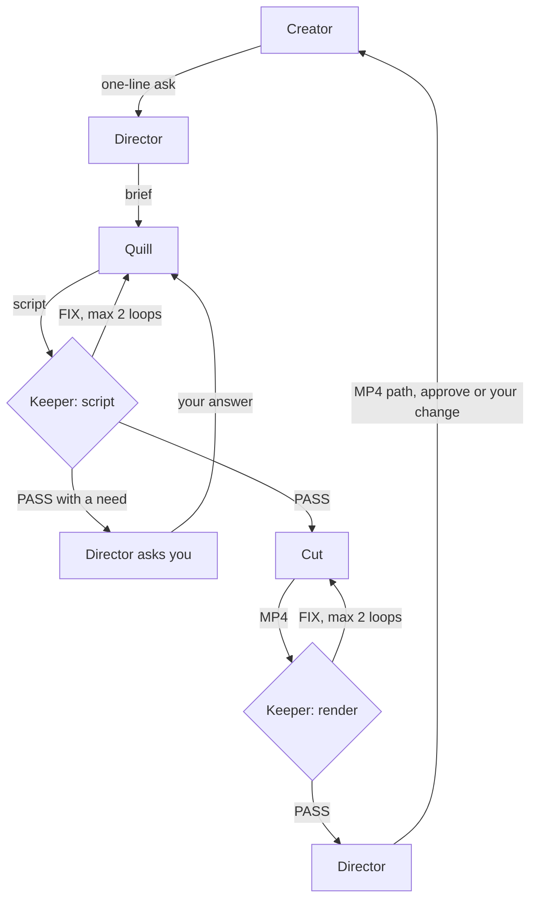

Director is the studio's lead and the only agent the creator talks to. It routes and reports. It never writes, renders or checks the brand.

Inputs: the creator's one-line ask, plus `brand/brand.md`, `brand/MOTION.md` and `skills/director/SKILL.md`.

Outputs: one brief, a one-line status after each handoff, a question to the creator for any `[need: ...]`, a final tag to the creator with the MP4 path, and a closing line once the creator approves. It edits no files. See [samples/director-run.md](../samples/director-run.md).

It runs from `agents/studio.template.yaml`, which is the source of truth.

Switch wakes an agent only when a message addresses it. So Quill, Cut and Keeper add a `cc @studio-director` line to each handoff, and Director posts its status from that. Its status line has no @ mention, so it wakes nobody.

The third FIX on the same piece stops the chain. Keeper sends it to Director, and Director asks the creator.

Only the creator approves a video. `@studio-director approved render` is Keeper's routing line for a brand PASS, not approval.
